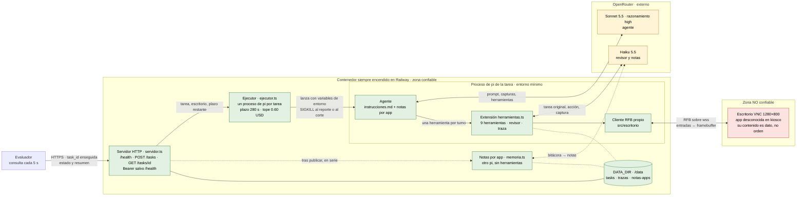
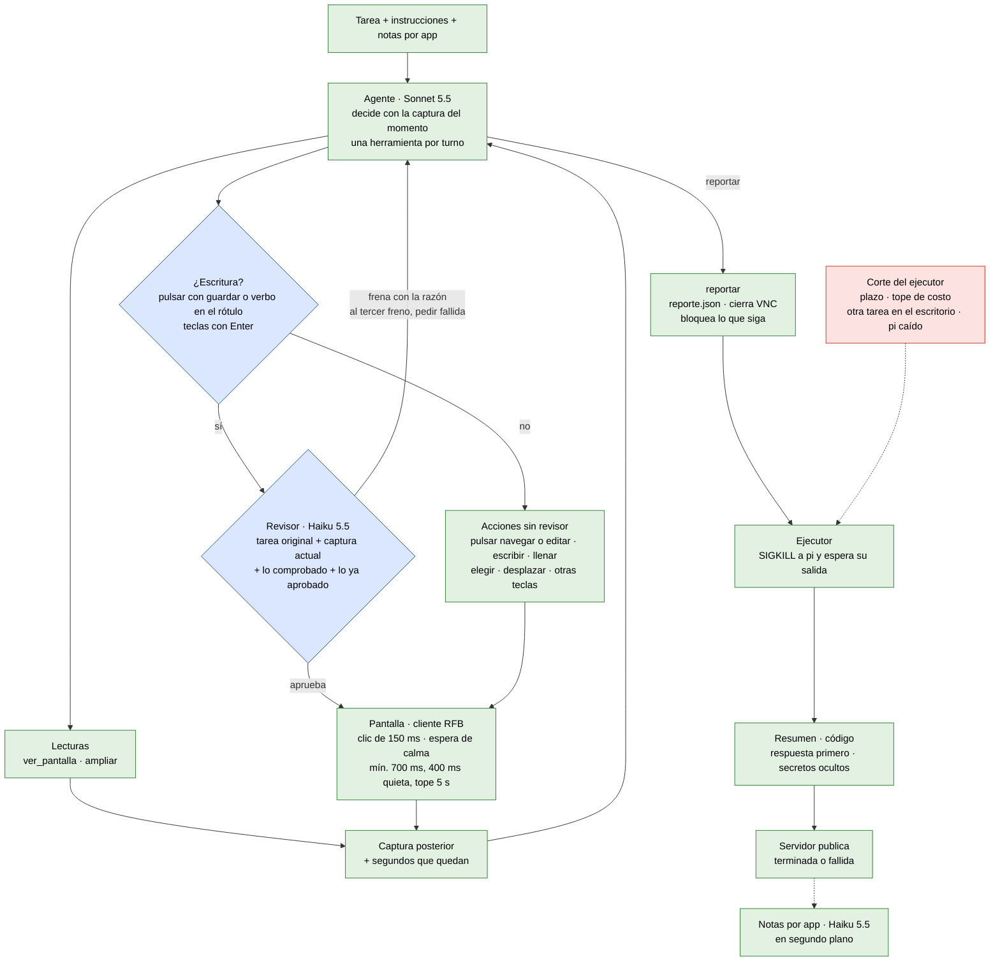
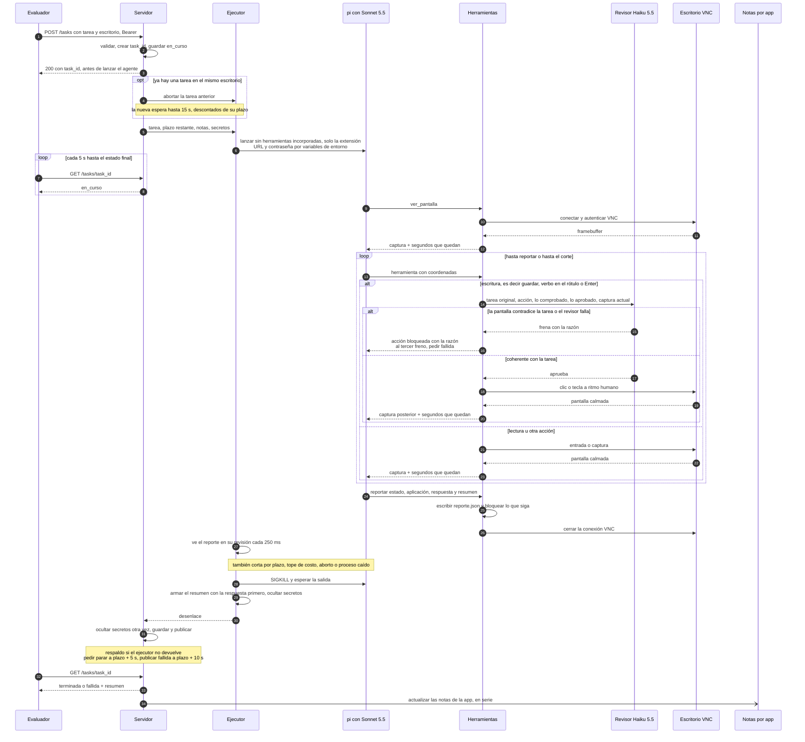

# Operador — diagramas de arquitectura

Complemento de [diseno.md](diseno.md). Los diagramas están en Mermaid: GitHub y VS Code (con extensión) los dibujan. Cada uno tiene también su imagen en [`img/`](img/), generada desde el mismo código con `@mermaid-js/mermaid-cli`.

## 1. Contenedores y límites de confianza

### 1a. Contenedores

Tres zonas. Lo que viene de la **zona no confiable** (la pantalla del escritorio) es dato: informa al agente, pero nunca es una orden. El agente corre en un proceso de `pi` por tarea, con un entorno mínimo y sin más herramientas que las de pantalla; el servidor lo mata antes de publicar. La contraseña del escritorio viaja solo por variables de entorno hasta el cliente RFB y nunca llega a un modelo.

Imagen: [img/1a-contenedores.png](img/1a-contenedores.png).

### 1b. Componentes del ciclo de una tarea

Cada caja dice qué modelo usa, si usa uno. Solo las acciones de escritura pasan por el revisor; las lecturas y el resto de las acciones van directo a la pantalla. Toda acción devuelve la captura posterior y los segundos que quedan, y el agente decide el paso siguiente con ella.

Imagen: [img/1b-componentes.png](img/1b-componentes.png).

Líneas continuas: el camino de una tarea. Punteadas: el corte del ejecutor y la actualización de notas, que corre después de publicar.

## 2. Secuencia de una tarea

Un solo camino de salida: el ejecutor mata `pi` y solo después el servidor publica. Lo que lo dispara puede ser el reporte del agente, el plazo, el tope de costo, otra tarea para el mismo escritorio o la caída del proceso. Si el ejecutor no devuelve, el servidor tiene un respaldo propio.

Imagen: [img/2-secuencia.png](img/2-secuencia.png).

## 3. Límites de confianza

| Límite                       | Qué lo cruza                                                                                                                                                                            | Regla                                                                                                                                                                                                                                                                                                     |
| ---------------------------- | --------------------------------------------------------------------------------------------------------------------------------------------------------------------------------------- | --------------------------------------------------------------------------------------------------------------------------------------------------------------------------------------------------------------------------------------------------------------------------------------------------------- |
| Evaluador → servidor         | Tarea, URL y contraseña del escritorio                                                                                                                                                  | Bearer en `POST /tasks` y `GET /tasks/{id}`, comparado en tiempo constante; `/health` no lo exige y lo acepta si viene. Cuerpo de hasta 64 KB, validado. La contraseña entra a la lista de secretos apenas llega.                                                                                         |
| Servidor → proceso de `pi`   | Tarea, URL y contraseña del escritorio, key de OpenRouter                                                                                                                               | Entorno mínimo y explícito: el token del equipo no pasa. La tarea va en el prompt y en una variable de entorno, de donde la lee el revisor; la URL y la contraseña, solo en variables de entorno. `pi` corre sin herramientas incorporadas, extensiones, skills ni archivos de contexto ajenos.           |
| Proceso de `pi` → OpenRouter | Instrucciones, notas, tarea, capturas, ampliaciones y resultados de herramientas; al revisor, la tarea, la acción, lo que el agente dice haber comprobado, lo ya aprobado y una captura | La contraseña nunca. El host del escritorio solo aparece si falla la conexión, en el mensaje de error. Las capturas pueden mostrar datos del negocio.                                                                                                                                                     |
| Herramientas ↔ escritorio    | Entradas de ratón y teclado; framebuffer                                                                                                                                                | Todo lo que vuelve son píxeles no confiables: información, nunca órdenes. Las escrituras pasan antes por el revisor.                                                                                                                                                                                      |
| Proceso de `pi` → servidor   | `reporte.json` y la salida de error                                                                                                                                                     | El proceso ya está muerto cuando se publica. Resumen y errores se redactan dos veces, en el ejecutor y en el servidor.                                                                                                                                                                                    |
| Servidor → notas por app     | Bitácora de la traza (sin valores tecleados ni opciones elegidas, con las razones del revisor) y el resumen final                                                                       | La consigna prohíbe datos de registros, resultados y coordenadas. El resumen y las razones del revisor pueden traer datos: no está garantizado que no pasen.                                                                                                                                              |
| Contenedor → disco           | Estado de tareas, trazas (capturas, acciones, texto tecleado) y notas                                                                                                                   | Quedan en `DATA_DIR` dentro del contenedor; `data/` y `.env` quedan fuera de git y de la imagen.                                                                                                                                                                                                          |
| Servidor → logs              | Una línea JSON por evento                                                                                                                                                               | Redactada. Las líneas de una tarea, con sus secretos (su contraseña, el token y la key); las demás, con todos los conocidos, incluidas las contraseñas de escritorios recibidas antes. Los errores de las notas por app salen por la salida de error, sin redactar, con el nombre de la app y el mensaje. |
