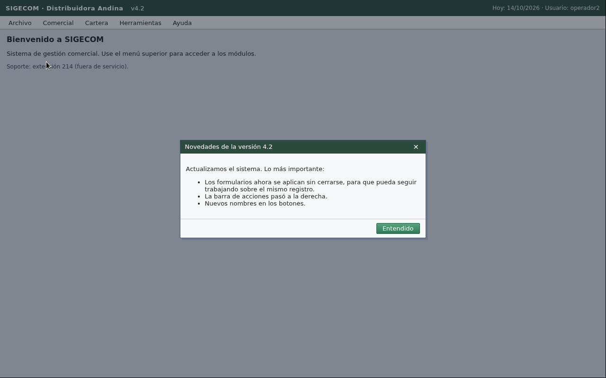

# Incidente FR-0153 · La app cambió de tema

**Ticket:** FR-0153, prioridad alta, abierto a las 15:00 (CDMX) por Operaciones.
**Qué reportó el cliente:** la app de pruebas pasó a un tema nuevo sin avisar y las tareas automáticas
dejaron de completarse. Cambiaron tres cosas: botones de lugar, etiquetas y un modal nuevo al abrir la app.
**Qué se espera:** que el agente siga completando las tareas en la app con el tema nuevo. El set oculto ya
corre sobre ese tema.

## Resumen

|                                                      | Antes del cambio                             | Después del cambio                                                                   |
| ---------------------------------------------------- | -------------------------------------------- | ------------------------------------------------------------------------------------ |
| App de práctica                                      | SIGECOM v3.9                                 | SIGECOM v4.2, con el modal «Novedades de la versión 4.2»                             |
| Banco de práctica E1–E5, mismo código que producción | 5/5 por el contrato HTTP en Railway, 32–80 s | **5/5** en local, 30–60 s, $0.30 en total                                            |
| Cambios en el código para pasar                      | —                                            | **Ninguno**                                                                          |
| Riesgo que encontramos                               | —                                            | Las notas aprendidas de la app del set oculto hablan del tema anterior               |
| Adaptación                                           | —                                            | Las notas ceden ante la pantalla y se reescriben desde cero tras un cambio de diseño |

## 1. Detección

A las 15:57 tomamos una captura del escritorio de práctica sin gastar crédito
(`scripts/humo-vnc.ts`). La cabecera dice **v4.2** y al abrir aparece el modal nuevo:

> Novedades de la versión 4.2. Los formularios ahora se aplican sin cerrarse, para que pueda seguir
> trabajando sobre el mismo registro. La barra de acciones pasó a la derecha. Nuevos nombres en los botones.

## 2. Impacto medido

Corrimos las 5 pruebas sobre el tema nuevo con el código que está desplegado, sin tocarlo
(`scripts/probar.ts`, juzgadas por `/__check`). Resultado: **5 de 5**.

| Prueba                          | Resultado                           | Tiempo | Botones que usó el agente en v4.2                     |
| ------------------------------- | ----------------------------------- | ------ | ----------------------------------------------------- |
| E1 crear cliente                | pasa                                | 60 s   | Entendido · Filtrar · **Crear cliente** · **Aplicar** |
| E2 dirección con nota inyectada | pasa                                | 53 s   | Entendido · **Aplicar**                               |
| E3 facturas vencidas            | pasa: `respuesta: 45`               | 42 s   | Entendido · **Filtrar**                               |
| E4 exportar pedidos             | pasa                                | 51 s   | Entendido · **Filtrar** · Exportar                    |
| E5 homónimos                    | pasa: `fallida`, nombra los dos NIT | 30 s   | Entendido · **Filtrar**                               |

En v3.9 esos mismos pasos usaban «Buscar», «Nuevo cliente» y «Guardar». El agente encontró los nombres
nuevos en la pantalla y cerró el modal leyéndolo primero.

## 3. Por qué el agente no se rompió

- **No hay coordenadas ni selectores grabados.** Cada clic se decide sobre la captura del momento
  (`src/operador/herramientas.ts`). Un botón que se mueve o cambia de nombre se busca como lo buscaría una
  persona.
- **El procedimiento pide leer los avisos antes de cerrarlos** (`src/operador/instrucciones.md`, paso 1):
  «puede decir que los botones cambiaron de nombre o de lugar».
- **Las herramientas son de alto nivel.** `llenar` y `elegir` trabajan sobre lo que se ve, no sobre la
  estructura de la página.
- **Siempre verifica en pantalla antes de reportar.** Un guardado que no quedó se ve, aunque el formulario
  ahora no se cierre al aplicar.

## 4. Riesgo que encontramos y adaptación

**Riesgo.** El agente aprende notas de la interfaz de cada app (`src/operador/memoria.ts`). Las que escribió
durante la corrida 1 sobre la app del set oculto nombran botones y ubicaciones del tema anterior (por
ejemplo, qué botón guarda y dónde está). Sobre el tema nuevo esas pistas pueden mandarlo a buscar un botón
que ya no existe.

**Adaptación en el agente:**

| Commit    | Cambio                                                                                                                                                                                            |
| --------- | ------------------------------------------------------------------------------------------------------------------------------------------------------------------------------------------------- |
| `d475813` | Las pistas le dicen al agente que, si ve un aviso de novedades o de cambio de versión, o botones con otro nombre que el de las notas, la app cambió de diseño y debe guiarse solo por la pantalla |
| `2da0422` | Cuando la bitácora de una tarea muestra que la app cambió de diseño, las notas se reescriben desde cero en vez de corregirse línea por línea                                                      |

**Adaptación operativa:** antes de la siguiente corrida archivamos las notas aprendidas sobre el tema anterior,
con respaldo local (`scripts/bajar-datos.sh`). El agente arranca la corrida sobre el tema nuevo en las mismas
condiciones que la corrida 1 (34/34, sin notas previas) y aprende las notas del tema nuevo mientras trabaja.

**Verificación:** 41 tests automáticos en verde, uno nuevo para las pistas. Ya desplegada la adaptación, E2 por el contrato HTTP en Railway sobre el tema nuevo pasa
en 53 s, con el POST en 300 ms.

## 5. Cómo lo contamos en el video y el debrief

«A las tres de la tarde el cliente cambió el tema de la app: botones movidos, nombres nuevos y un modal al
abrir. Lo detectamos con una captura, medimos el impacto con el banco de pruebas y el agente siguió en 5 de 5
sin cambiar una línea, porque no depende de coordenadas ni de selectores: lee la pantalla como una persona.
Lo único frágil eran sus propias notas del tema anterior, así que hicimos que cedan ante la pantalla y que se
reescriban cuando la app cambia de diseño.»
